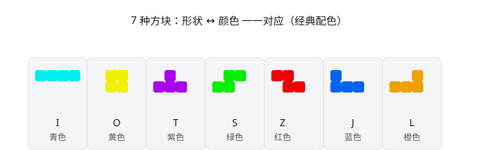

# 俄罗斯方块（Tetris）

一个用 **Python 标准库 `tkinter`** 实现的经典俄罗斯方块游戏，**零第三方依赖**，开箱即玩。

---

## 特性

- **7 种标准方块**（I / O / T / S / Z / J / L），各配独立经典颜色（青 / 黄 / 紫 / 绿 / 红 / 蓝 / 橙）
- **旋转系统**：↑ / X 顺时针、Z 逆时针，带**墙踢（wall kick）**，贴墙也能转
- **下落控制**：↓ 软降、空格 硬降（直接落底）、自动定时下落（速度随等级提升）
- **幽灵投影**：半透明显示当前方块落点，方便规划落位
- **消行计分**：单/双/三/四消分别得 100 / 300 / 500 / 800 分（再乘以当前等级）；每消 10 行升一级，下落加速
- **粒子特效**：方块消除时迸发彩色粒子，带重力与淡出
- **塌落动画**：被消行上方的方块会平滑下落填补空隙
- **右侧信息面板**：下一个方块预览、分数、等级、消行数
- **开始界面**：启动后显示「开始游戏」覆盖层，**点击按钮或按回车**进入；开始前方块不自动下落、也不接受操作输入；覆盖层上同时提供「设置」按钮，可在进入游戏前调整配置。**彩色模式下覆盖层背景跟随棋盘背景色（在设置中可自定义），文字颜色按底色明暗自动取反以保证可读**
- **退出按钮**：游戏内面板底部「退出」按钮（或 Alt+W）可直接关闭窗口
- **设置面板**：开始界面与游戏内均可通过「设置」按钮打开设置窗口，可调整**粒子数量**（每格 0–12，0 = 关闭特效）、**方块切口大小**（四角切掉 0–12px，0 = 直角方块；拖动滑块时窗口内右侧会实时显示一个方块预览——彩色模式为黄色、黑白模式为灰色）、切换**彩色 / 黑白**配色，以及**自定义棋盘背景色（仅彩色模式）**。背景色设置内含**取色器**：S/V 渐变方块 + 彩虹色相条 + R/G/B 三个数字输入框，旁边有当前色块与十六进制色值预览；拖动或输入时**实时预览**棋盘与开始界面底色（确定前不写盘）。窗口底部另提供「**恢复默认**」按钮，一键将所有设置项恢复到默认值。打开设置时方块自动暂停下落，关闭后从原状态继续。**在黑白（深色）模式下：背景色自定义区块整块隐藏（黑白模式不受背景色影响），切角预览块与两条拖动条的槽显示为灰色、拖动块保持黑色**
- **彩色 / 黑白模式**：面板底部「彩色模式 / 黑白模式」按钮随时切换。**彩色（经典）模式的棋盘为可自定义纯色背景（默认纯蓝 `#e2f3ff`，网格线按底色自动取浅/深对比色）＋ 7 种彩色方块**，按钮为「彩色模式」（蓝）、「退出」（红）等彩色圆角按钮、面板文字为白色；**黑白模式为纯黑底 + 统一深灰方块 + 深灰按钮**，黑底上的文字为深灰（方块以略亮的同色描边区分轮廓），且不受背景色自定义影响
- **八边形方块与圆角按钮**：所有方块（含幽灵投影、下一个预览）都是 **Canvas 自绘的切角正方形（正八边形）**——四个角按 45° 直线削掉一个直角，切口大小可在设置里调节（0–12px，0 = 直角方块），方块内再套一圈略亮的同色描边作为高光；开始游戏、设置、彩色/黑白切换、退出以及设置窗口的「确定 / 取消」按钮则采用圆角矩形样式（圆角矩形 + 文字 + 悬停高亮）
- **设置本地记忆**：当前配色、粒子数量、方块切口与棋盘背景色自动保存到 `tetris_settings.json`，下次启动自动套用
- **暂停 / 重开** + 游戏结束弹窗

---

## 方块与颜色

每种形状在游戏里固定对应一种颜色，二者一一绑定：



| 形状 | 颜色 |   | 形状 | 颜色 |
| -- | -- | - | -- | -- |
| I  | 青色 |   | S  | 绿色 |
| O  | 黄色 |   | Z  | 红色 |
| T  | 紫色 |   | J  | 蓝色 |
|    |    |   | L  | 橙色 |

> 配色取自 `tetris.py` 的 `SHAPES`（经典配色）：I 青、O 黄、T 紫、S 绿、Z 红、J 蓝、L 橙。

---

## 运行方法

### 方式一：双击启动（推荐）

直接双击 `run.bat` 即可。它会调用 PATH 中的 `python` 运行 `tetris.py`。

> 前提：你的机器上 `python` 已加入环境变量，且为带有 `tkinter` 的 Python 3.x（Windows 版官方 CPython 自带）。  
> 若双击后提示 “'python' 不是内部或外部命令”，说明 PATH 未配置 `python`，请用方式二。

### 方式二：命令行启动

```bash
cd /path/to/俄罗斯方块
python tetris.py
```

若系统有多个 Python，可指定完整路径，例如：

```bash
"C:\Users\你的用户名\AppData\Local\Programs\Python\Python313\python.exe" tetris.py
```

---

## 操作说明

| 按键      | 作用            |
| ------- | ------------- |
| ← / →   | 左右移动          |
| ↓       | 软降（加速下落，得分加成） |
| 空格      | 硬降（直接落到底部）    |
| ↑ / X   | 顺时针旋转         |
| Z       | 逆时针旋转         |
| P       | 暂停 / 继续       |
| Esc     | 暂停 / 继续       |
| R       | 重新开始          |
| 回车      | 开始游戏（在开始界面时）  |
| 退出按钮   | 关闭游戏（面板底部按钮） |
| 设置按钮   | 打开设置窗口（粒子数量 / 方块切口 / 彩色·黑白 / 棋盘背景色），开始界面与游戏内均有 |
| 彩色/黑白按钮 | 切换经典彩色 / 黑白（黑底灰块）配色 |
| Alt + W | 关闭游戏          |

> 提示：`Esc` 与 `P` 都可用于暂停；开始界面下按「回车」或点击「开始游戏」按钮进入游戏，也可先点「设置」调整粒子数量、方块切口与配色；关闭窗口可用面板「退出」按钮或 `Alt+W`；「设置」按钮可调整粒子数量（拖动时右侧有黄色方块预览）、方块切口与配色，调整即时保存并记忆到本地，**打开设置窗口时方块会自动暂停下落**，关闭后继续。

---

## 计分与等级

| 一次消除行数      | 得分       |
| ----------- | -------- |
| 1 行         | 100 × 等级 |
| 2 行         | 300 × 等级 |
| 3 行         | 500 × 等级 |
| 4 行（Tetris） | 800 × 等级 |

- 每累计消除 **10 行** 升一级
- 等级越高，方块自动下落越快（`fall_speed = max(80, 500 − (等级−1) × 40)` 毫秒）

---

## 文件结构

```
俄罗斯方块/
├── tetris.py          # 游戏主体（纯标准库 tkinter）
├── run.bat            # 一键启动脚本（调用 python tetris.py）
├── tetris_settings.json # 本地设置（粒子数量、方块切口、配色、棋盘背景色），自动生成与记忆
├── shape_color_map.svg # 方块形状↔颜色对照图（经典配色）
└── README.md          # 本文件
```

---

## 常见问题

### 排错

**Q：双击 `run.bat` 后窗口一闪而过 / 没反应？**  
A：说明系统没找到 `python`。请确认 Python 已加入 PATH 环境变量，或改用「运行方法 → 方式二」在命令行指定完整路径运行——命令行会显示具体报错，便于定位。

**Q：游戏里的中文显示为方块 / 乱码？**  
A：本游戏已对中文统一使用系统真实存在的中文字体（自动检测 微软雅黑 → 黑体 → 宋体 等），正常情况下不会乱码。若仍异常，多半是系统缺失对应中文字体，可在 `tetris.py` 的 `_cjk_font_name()` 中补充字体名。

**Q：打开后提示缺少 `tkinter` / 无法启动？**  
A：请使用带 `tkinter` 的官方 CPython（Windows 版自带）。若自行精简过 Python 或用的是不含 tkinter 的发行版，需换用完整版 CPython 3.x。

**Q：退出游戏时控制台出现 `alloc: invalid block` 之类的提示？**  
A：这是 Tk（tkinter 底层）在退出清理阶段的内存分配器告警，程序此时已正常关闭，不影响已保存的设置或游戏数据，可忽略。

### 功能

**Q：能加音效 / 连击加分吗？**  
A：目前未实现。可在此基础上扩展——`tetris.py` 的 `Tetris` 类负责游戏逻辑、`TetrisGUI` 负责渲染与特效，新增逻辑相对独立。

---

## 实现说明（对开发者）

- `Tetris` 类：**纯游戏逻辑**，不依赖任何 UI。包含棋盘、当前/下一个方块、旋转状态、消行、计分、等级、塌落动画状态机（`play` / `clearing`）。
- `TetrisGUI` 类：**tkinter 渲染与交互**。负责画布绘制、粒子系统、键盘绑定与主循环；配色由 `THEMES` 主题表管理（`classic` 纯蓝棋盘 `#e2f3ff` + 彩色方块 / `dark` 纯黑底 + 深灰方块），渲染统一经 `_color_of(name)` 取色，面板「彩色/黑白模式」按钮调用 `_toggle_theme` / `_set_theme` 切换。方块与按钮分成两套绘制：**方块格子经 `_octagon` 绘成八边形**——正方形四角按 45° 直线切掉 `self.cell_cut` 像素（设置在 0–12 之间可调，默认 6px），`_draw_cell` 画本体 + 内圈同色描边高光，幽灵投影与「下一个」预览同形状；**按钮经 `_round_rect` 绘成圆角矩形**（半径 10px，`_make_round_button` 支持点击与悬停高亮，配色由 `_btn_colors` 按主题返回——彩色模式为蓝/红/灰按钮、黑白模式为深灰按钮）。在黑底上用 `_cell_outline` 返回「略亮的同色描边」以区分方块轮廓（黑白模式同此逻辑，彩色模式用黑色描边）。
- **设置与本地记忆**：模块级 `load_settings()` / `save_settings()` 读写 `tetris_settings.json`（字段 `particle_count` 0–12、`cell_cut` 0–12、`theme` 为 `classic`/`dark`、`bg_color` 为 `#rrggbb`）。`DEFAULT_SETTINGS` 统一定义全部默认值（含背景色 `DEFAULT_BG_COLOR = "#e2f3ff"`），`load_settings` 会对 `bg_color` 做十六进制合法性校验。`TetrisGUI.__init__` 启动时加载并设置初始配色、粒子数、方块切口（`self.cell_cut`）与背景色（`self.bg_color = settings["bg_color"]`）；面板「设置」按钮（`_build_setting_button` + `_open_settings`）提供滑块调粒子数量、滑块调方块切口（右侧实时黄色方块预览，经 `_octagon_points` 重绘）、单选切换彩色/黑白，以及背景色取色器，确认后写盘并即时套用。**打开设置时 `settings_open` 置真，主循环 `_loop` 跳过 `tick` 使方块暂停下落，关闭后恢复。**
- **自定义棋盘背景色（彩色模式）**：`self.bg_color` 默认为 `#e2f3ff`，可在设置取色器里调整。棋盘底色由 `_board_bg()` 返回（黑白模式返回主题黑底）；网格线色由 `_grid_color()` 用 `contrast_color` 按底色亮度自动取对比色（亮底压暗 / 暗底提亮，黑白模式直接用主题色）；开始界面底色由 `_start_bg()` 返回，文字色由 `_start_text_colors()` 按底色明暗自动取深 / 浅以保证可读，二者经 `_paint_start_screen` 在切换主题或自定义底色时刷新。取色器在 `_open_settings` 内用纯标准库手绘实现：**`hsv_square_png()` 手写 PNG（zlib + struct 生成 S/V 渐变，再由 `tk.PhotoImage` 解码）** 作调色板，配合彩虹色相条与 R/G/B 三个 `Spinbox`；内部经 `_sync` 统一刷新色块、十六进制标签、十字光标与实时预览（`_apply_bg_live` 只套用不写盘），「取消」会还原未确认的底色、「确定」写盘并套用、「恢复默认」一键复位为 `DEFAULT_SETTINGS`。当颜色模式切换到**黑白**时，`_on_mode_change` 会**隐藏背景色区块**并将两条拖动条的槽、`_draw_preview` 的预览块改为灰色（拖动块保持黑色）。颜色工具 `is_hex_color / hex_to_rgb / rgb_to_hex / mix_rgb / luminance / is_light / contrast_color` 均为零依赖纯函数。
- 粒子数量由 `TetrisGUI.particle_count` 控制（来自设置），`spawn_clear_particles` 按此值为每格生成粒子；设为 0 即关闭特效。
- 开始界面：`_show_start_screen` 生成覆盖层（标题 + 圆角「开始游戏」与「设置」按钮 + 操作提示），`started` 状态门控——开始前不自动下落、输入经 `_safe` 包装忽略；点击「开始游戏」或回车调用 `_start_game`（幂等）进入游戏，点击「设置」调用 `_open_settings`。开始界面的按钮配色由 `_start_btn_colors` 随主题刷新（`_paint_start_screen` 中一并重绘）。面板底部圆角「退出」按钮（`_build_quit_button`）与 `Alt+W` 均可关闭窗口。
- 旋转采用 7 种方块的 `ROTATIONS` 表，每步均为标准 90° 旋转（含墙踢）。

> 为何不用 pygame：本环境无法便捷安装 pygame（Python 3.13 缺预编译 Windows 轮子），故改用标准库 `tkinter`，保证用户无需安装任何依赖即可运行。


---

## 许可证

仅供学习与交流使用。
